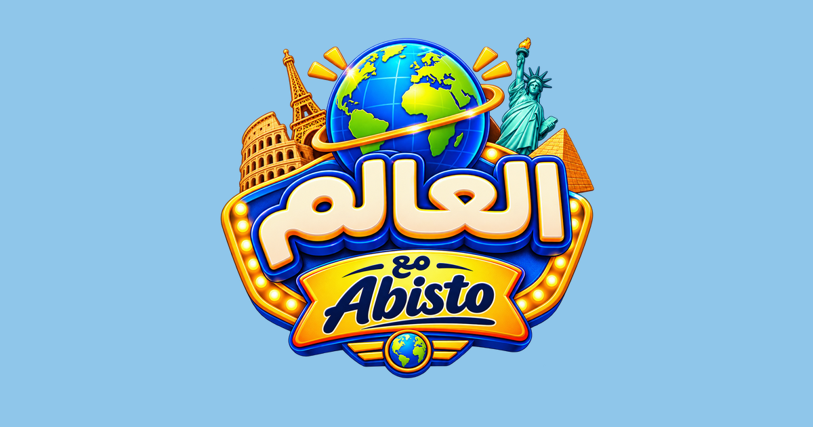

<p align="center">
  
</p>

<h1 align="center">Globe by Abisto · العالم مع Abisto</h1>

<p align="center">
  A free geography game for your phone or computer: flags, countries, capitals and cities.<br>
  No sign-up and nothing to install. Open it and you're playing.
</p>

<p align="center"><b><a href="https://abistoufisbot.github.io/Globe-by-Abisto/">▶ Play now</a></b></p>

<p align="center">
  Follow <b>@abisto26</b>:
  <a href="https://www.instagram.com/abisto26">Instagram</a> ·
  <a href="https://www.tiktok.com/@abisto26">TikTok</a> ·
  <a href="https://www.youtube.com/@abisto26">YouTube</a> ·
  <a href="https://www.facebook.com/abisto26">Facebook</a>
</p>

---

## How to play

Pick a game at the top, answer, and see how far you can go.

- You have **3 lives**. A wrong answer costs one.
- You have **15 seconds** for each question. If time runs out, it counts as a miss.
- Every **10 right answers in a row** gives you a life back.
- Your score is the number of right answers. Get **3 or more** to win the 🏅.

| Game | Easy | Pro |
|---|---|---|
| **Flags** | Pick the country from 4 choices | Find it on the map |
| **Countries** | Pick from 4 neighbouring countries | — |
| **Capitals** | Choose from 4 nearby capitals | Choose from 4 cities in the same country |
| **Cities** | Find the city on a map zoomed to its country | Find it on the world map, within 1000 km |

**Explore** (🧭) is for learning: tap any country to see its flag, capital and biggest cities.

## Features

- **4 languages:** English, French, Arabic and Russian.
- **Light and dark mode.**
- **Works offline.** Once you've opened it, the game plays without a connection, even in airplane mode. Scores you make offline go on the leaderboard when you're back online.
- **Works on any phone.** Add it to your home screen and it opens like an app:
  - **iPhone:** in Safari, tap Share, then *Add to Home Screen*.
  - **Android:** in Chrome, open the ⋮ menu, then *Add to Home screen*.
- **Leaderboard** for each game and level.
- **Avatars:** pick a famous traveller (Ibn Battuta, Marco Polo, Amelia Earhart, Valentina Tereshkova…) or an animal, shown on the leaderboard.
- **Achievements** on your profile (tap your name in ⚙︎): 🌍 World tour for playing a whole list, 🔥 On fire for 25 or 50 right in a row, 👑 Champion for reaching #1.

## Leaderboard and your data

The leaderboard is optional. You can always play without a username.

- To appear on it, pick a **username** and a **4-digit PIN** on the start screen.
- To use the same username on another phone or browser, enter it with your PIN.
- Other players only see usernames and scores.
- Nothing else about you is stored: no email and no account. Your PIN is stored scrambled (hashed), never as typed.
- Keep your PIN to yourself, and don't reuse a PIN you use for anything important.

## Built with

- [D3](https://d3js.org) and [topojson-client](https://github.com/topojson/topojson-client) for the map, with [world-atlas](https://github.com/topojson/world-atlas) country shapes (Natural Earth)
- [flag-icons](https://github.com/lipis/flag-icons) for the flags
- [Convex](https://convex.dev) for the leaderboard
- Fonts: Bricolage Grotesque, IBM Plex Mono (with Cyrillic) and IBM Plex Sans Arabic (SIL Open Font License)

Licence texts for these are in [`licenses/`](licenses).

## Project layout

```
index.html        the game, built into one file
src/              the source: game.src.html, map and flag data, translations
convex/           leaderboard server functions
build.js          rebuilds index.html and sw.js from src/  →  node build.js
sw.js             offline copy of the game (generated)
fonts/            bundled fonts
icons/            app icons
```

## Follow Abisto

**@abisto26** on
[Instagram](https://www.instagram.com/abisto26) ·
[TikTok](https://www.tiktok.com/@abisto26) ·
[YouTube](https://www.youtube.com/@abisto26) ·
[Facebook](https://www.facebook.com/abisto26)

---

<p align="center">Made by Abisto 🌍</p>
